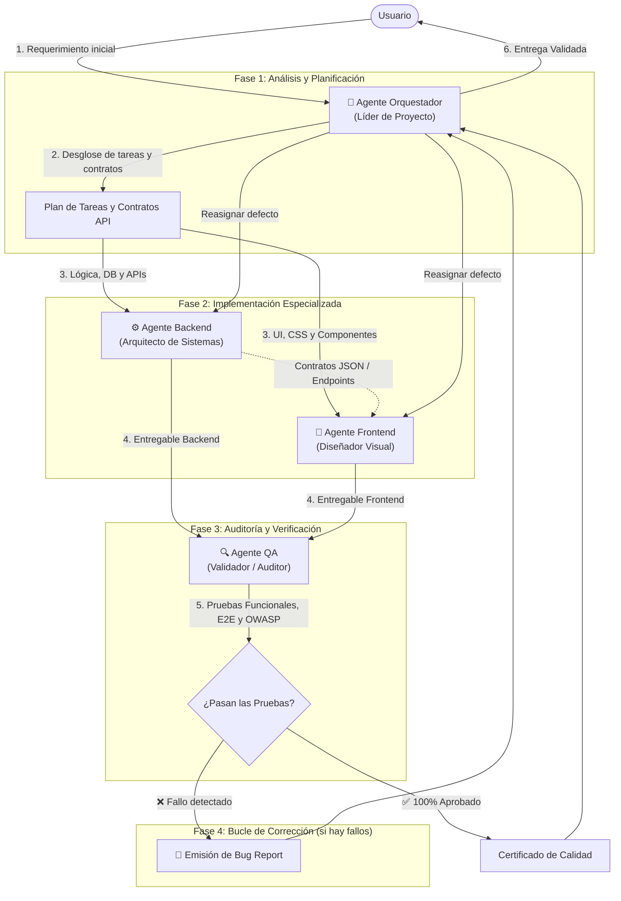

# Equipo de Agentes IA para Desarrollo Web

Este directorio contiene la configuración y definición del **Equipo Especializado de Agentes IA** para proyectos de desarrollo web en Google Antigravity. Cada agente cuenta con un rol delimitado, herramientas curadas y reglas estrictas para garantizar un flujo de trabajo profesional, modular y de alta calidad.

---

## 👥 Miembros del Equipo

| Agente | Archivo | Rol | Modelo | Invocación | Herramientas Clave |
| :--- | :--- | :--- | :--- | :--- | :--- |
| **Orquestador** | [`agente-orquestador.md`](file:///c:/Users/giral/Downloads/PRAXIS/develop-praxys/.agents/agents/agente-orquestador.md) | Líder de Proyecto / Tech Lead | `pro` | Principal (`mainAgent`) | Inspección, planeación, orquestación |
| **Frontend** | [`agente-frontend.md`](file:///c:/Users/giral/Downloads/PRAXIS/develop-praxys/.agents/agents/agente-frontend.md) | Diseñador Visual / UI & UX | `flash` | Principal y Subagente | Edición de código, `browser_subagent`, `generate_image`, linters |
| **Backend** | [`agente-backend.md`](file:///c:/Users/giral/Downloads/PRAXIS/develop-praxys/.agents/agents/agente-backend.md) | Arquitecto de Sistemas / APIs | `pro` | Principal y Subagente | Edición de código, migraciones, scripts de servidor, testing |
| **QA** | [`agente-qa.md`](file:///c:/Users/giral/Downloads/PRAXIS/develop-praxys/.agents/agents/agente-qa.md) | Validador / Control de Calidad | `pro` | Principal y Subagente | `browser_subagent`, suites de pruebas, auditoría OWASP |

---

## 🔄 Flujo de Trabajo y Ciclo de Vida



---

## 📌 Reglas de Oro de los Agentes

1. **Agente Orquestador:**
   - **Regla:** **Nunca escribe código funcional directamente.** Su función es analizar, descomponer en subtareas, delegar y resolver dependencias entre agentes.
2. **Agente Frontend:**
   - **Regla:** **Se enfoca exclusivamente en la experiencia visual y la interactividad.** No implementa bases de datos ni lógica de servidor. Consume los contratos de API del Backend.
3. **Agente Backend:**
   - **Regla:** **Prioriza la seguridad y la funcionalidad del código oculto al usuario.** No diseña estilos ni maquetación visual; expone APIs seguras y documentadas.
4. **Agente QA:**
   - **Regla:** **Si detecta un error, NUNCA lo parcha él mismo.** Informa mediante un *Bug Report* estructurado al Orquestador para que el agente responsable aplique la corrección.

---

## 🚀 Cómo Invocar y Utilizar los Agentes

### 1. Desde la Interfaz Gráfica (Antigravity 2.0 GUI)
- En la parte superior de la ventana de chat, haz clic en el selector desplegable de agentes.
- Selecciona el agente deseado (por ejemplo, `agente-orquestador` para iniciar un proyecto completo o `agente-frontend` para trabajar directamente en la UI).

### 2. Desde la Línea de Comandos (Antigravity CLI)
```bash
# Iniciar una sesión con el Líder Orquestador
agy --agent agente-orquestador

# Iniciar una sesión directa con el Diseñador Frontend
agy --agent agente-frontend

# Iniciar una sesión directa con el Arquitecto Backend
agy --agent agente-backend

# Iniciar una sesión directa con el Validador QA
agy --agent agente-qa
```

### 3. Delegación Asíncrona (Subagentes)
El `agente-orquestador` puede invocar a los demás agentes como subagentes en segundo plano usando su identificador (`TypeName: "agente-frontend"`, `"agente-backend"`, `"agente-qa"`), permitiendo trabajo paralelo sin bloquear la interacción con el usuario.
