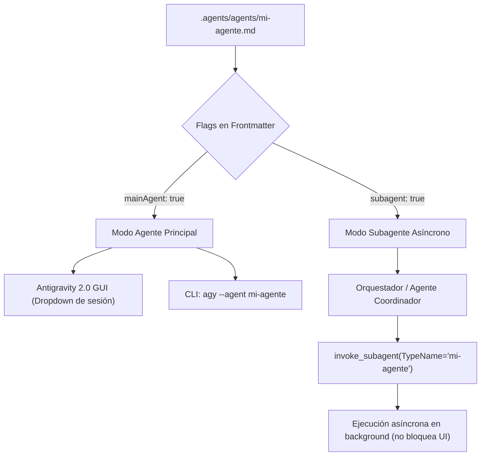

# Agentes Personalizados en Google Antigravity

Esta habilidad proporciona el conocimiento técnico, arquitectura, especificación de formato y procedimientos paso a paso para crear, configurar e invocar **Agentes Personalizados (Custom Agents)** en proyectos de Antigravity.

---

## 1. Fundamentos y Propósito

En la era del desarrollo centrado en agentes, la ingeniería de software ha evolucionado de escribir código línea a línea a **orquestar equipos de agentes especializados**.

Los asistentes de propósito general enfrentan dos problemas críticos:
1. **Falta de especialización:** Desconocen convenciones locales de testing, arquitecturas específicas del repositorio o flujos de trabajo particulares a menos que se les explique en cada prompt.
2. **Sobrecarga de contexto (Context Window Bloat):** Inyectar instrucciones monolíticas y reglas globales en cada conversación agota el presupuesto de tokens y degrada la capacidad de razonamiento del modelo.

### ¿Qué son los Custom Agents?
Son configuraciones declarativas basadas en un archivo Markdown (`.md`) con encabezado YAML frontmatter que definen:
- Un **rol y propósito especializado**.
- Un conjunto restringido y curado de **herramientas (tools)** y **habilidades (skills)**.
- Un **prompt de sistema propio** derivado del cuerpo Markdown.
- **Políticas de seguridad y permisos** granulares (modo de ejecución de comandos).
- **Simetría de ejecución:** Capacidad de actuar tanto como agente principal (*main agent*) como trabajador en segundo plano (*subagent*).

---

## 2. Ubicación y Descubrimiento de Archivos

Los agentes personalizados se definen como archivos individuales con extensión `.md` en dos niveles:

| Nivel | Ruta de Almacenamiento | Ámbito y Uso |
| :--- | :--- | :--- |
| **Proyecto / Workspace (Recomendado)** | `.agents/agents/<nombre-agente>.md` | Específico del repositorio. Se versiona en Git para que todo el equipo disponga de los mismos agentes estandarizados sin configuración manual. |
| **Global (Usuario / Máquina)** | `~/.gemini/config/agents/<nombre-agente>.md` | Disponible de forma transversal en todos los proyectos abiertos en el equipo local. |

> [!IMPORTANT]
> Para este proyecto, todos los agentes locales deben residir en `.agents/agents/`. Antigravity los detecta automáticamente mediante descubrimiento progresivo a partir de la raíz del workspace.

---

## 3. Especificación del Formato de Archivo

Cada agente se estructura en un único archivo Markdown compuesto por:
1. **Encabezado YAML Frontmatter** (entre delimitadores `---`): Metadatos, flags de ejecución, modelo, herramientas y políticas.
2. **Cuerpo Markdown**: Instrucciones de sistema (*system prompt*) compiladas directamente en el bucle del agente.

### 3.1. Campos del YAML Frontmatter

```yaml
---
name: dependency-modernizer
description: Actualiza dependencias de paquetes y verifica que la suite de pruebas del proyecto pase.
model: flash
mainAgent: true
subagent: true
permissionMode: acceptEdits
commandExecutionPolicy: auto
tools:
  - view_file
  - replace_file_content
  - run_command
  - manage_task
skills:
  - skills/package-upgrade-rules
---
```

#### Descripción Detallada de Campos:

- **`name`** *(string, obligatorio)*: Identificador único del agente en minúsculas y separado por guiones (slug), por ejemplo `dependency-modernizer`, `code-reviewer`, `db-migrator`.
- **`description`** *(string, obligatorio)*: Explicación concisa y funcional de lo que hace el agente y en qué situaciones debe usarse. Es leída por el orquestador/coordinador para decidir delegaciones automáticas.
- **`model`** *(string, opcional)*: Nivel o familia del modelo a instanciar al ejecutar este agente. Valores comunes:
  - `inherit` (predeterminado): Hereda el modelo de la sesión activa.
  - `flash` o `flash_lite`: Modelos rápidos y económicos, óptimos para tareas mecánicas, búsqueda o modernización de dependencias.
  - `pro`: Modelo con alta capacidad de razonamiento para arquitectura, refactorización compleja y análisis crítico.
- **`mainAgent`** *(boolean, opcional, default: `false`)*: Habilita al agente para ser seleccionado y ejecutado como **agente principal** de la sesión interactiva.
- **`subagent`** *(boolean, opcional, default: `false`)*: Habilita al agente para ser delegado e invocado como **subagente** en segundo plano.
- **`tools`** *(lista de strings, opcional)*: Lista explícita y curada de herramientas disponibles para el agente. Si se define, el agente solo tendrá acceso a estas herramientas, evitando confusión y reduciendo tokens consumidos.
  - Ejemplos: `view_file`, `replace_file_content`, `write_to_file`, `run_command`, `manage_task`, `read_url_content`, `search_web`.
- **`skills`** *(lista de strings, opcional)*: Rutas o identificadores de las habilidades que este agente puede consultar. Filtra el ecosistema de skills a solo las relevantes para su especialidad.
- **`permissionMode`** *(string, opcional)*: Nivel general de permisos del agente (por ejemplo: `acceptEdits`, `bypassPermissions`, `default`).
- **`commandExecutionPolicy`** *(string, opcional)*: Política de ejecución de comandos de terminal:
  - `auto`: Permite ejecutar automáticamente en segundo plano comandos seguros y comunes (tests, linters, compilación) sin pedir confirmaciones constantes, manteniendo bloqueadas las acciones destructivas (borrado de archivos, operaciones de red no autorizadas).
  - `off`: Requiere aprobación manual para cualquier ejecución de comando.
  - `eager` / `sandbox`: Ejecución directa en entornos aislados o según políticas corporativas.
- **`mcp`** *(objeto/lista, opcional)*: Servidores de Model Context Protocol (MCP) autorizados y montados específicamente para el agente.

### 3.2. Cuerpo Markdown (Instrucciones de Sistema)

El texto ubicado después del segundo delimitador `---` se convierte en las **instrucciones de sistema directas** del agente. Debe estructurarse con claridad:
1. **Rol y Objetivo Principal**: Quién es el agente y cuál es su meta.
2. **Flujo de Trabajo Operativo**: Fases paso a paso para ejecutar su labor.
3. **Criterios de Verificación y Salida**: Cómo debe validar el éxito (tests verdes, linters limpios, reportes generados).
4. **Límites y Restricciones**: Qué acciones nunca debe realizar de forma autónoma.

---

## 4. Invocación y Simetría de Ejecución

Una de las innovaciones distintivas de Antigravity frente a otros entornos es la **Simetría de Ejecución Real**:



### 4.1. Invocación como Agente Principal (`mainAgent: true`)
Permite interactuar directamente con el agente especializado desde el inicio de la sesión:
- **Desde la interfaz gráfica (Antigravity 2.0 GUI):** Seleccionándolo en el menú desplegable de agentes en la cabecera del chat.
- **Desde la línea de comandos (Antigravity CLI):**
  ```bash
  agy --agent dependency-modernizer
  ```
- **Comportamiento:** Sus instrucciones de sistema toman el control de la conversación y asume directamente las herramientas y permisos especificados.

### 4.2. Invocación como Subagente Asíncrono (`subagent: true`)
Permite a un agente coordinador delegar tareas paralelas o pesadas sin contaminar su contexto:
- El agente coordinador detecta la necesidad a partir del campo `description`.
- Se invoca mediante la herramienta de subagentes delegada (`invoke_subagent` o llamada interna):
  ```json
  {
    "TypeName": "dependency-modernizer",
    "Role": "Dependency Updater",
    "Prompt": "Actualiza la biblioteca date-fns a la última versión y corre la suite de pruebas."
  }
  ```
- **Ejecución Asíncrona:** El subagente corre en segundo plano como tarea aislada, reportando su estado y resultados vía mensajería sin congelar la ventana principal del usuario.

---

## 5. Procedimiento Paso a Paso para Crear un Agente

Cuando se requiera crear un nuevo agente en este proyecto, sigue este procedimiento:

1. **Definir el Alcance y Especialización:**
   - ¿Qué problema puntual resuelve?
   - ¿Qué herramientas mínimas necesita?
   - ¿Debe correr como principal (`mainAgent`), como subagente (`subagent`), o ambos?

2. **Crear el Archivo en `.agents/agents/`:**
   - Crear el directorio `.agents/agents/` si no existe.
   - Guardar el archivo como `<nombre-descriptivo>.md`.

3. **Configurar el YAML Frontmatter Riguroso:**
   - Asignar `name`, `description`, `model`, `tools`, `mainAgent`, `subagent`, `commandExecutionPolicy`.

4. **Redactar las Instrucciones de Sistema:**
   - Definir pasos secuenciales y métodos de verificación automática (ej. ejecutar tests con `run_command`).

5. **Verificación y Prueba:**
   - Comprobar sintaxis YAML.
   - Probar su invocación vía CLI (`agy --agent <nombre>`) o delegación.

---

## 6. Recursos y Plantillas Relacionadas

- Plantilla lista para usar: [blueprint-template.md](./references/blueprint-template.md)
- Ejemplo oficial del Modernizador de Dependencias: [dependency-modernizer.md](./examples/dependency-modernizer.md)
